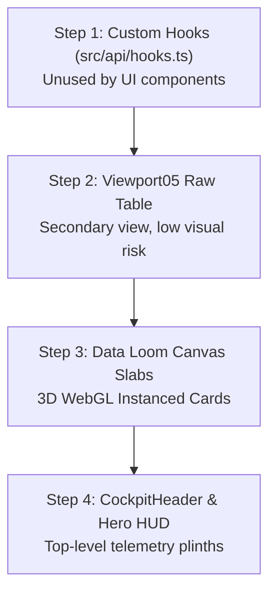

# Phase 3 UI Integration Implementation Plan

**Status:** Plan Specification Only  
**Branch:** `integration/backend-wiring`  
**Standing Rule:** Read-only plan. No UI components in `src/components/` or `src/core/` are modified in this phase.

---

## 1. Exhaustive UI Data Mapping Matrix

Mapping every UI element identified in [UI_DATA_INVENTORY.md](file:///c:/Users/steph/Desktop/Git/Secullarius/docs/integration/UI_DATA_INVENTORY.md) to backend endpoints and provenance:

| UI Element | File:Line | Current Source | Proposed Source | Depends on `txKind`? | Proposed Visible Copy | Risk & Mitigation |
| :--- | :--- | :--- | :--- | :--- | :--- | :--- |
| **Cockpit Root State** | `CockpitHeader.tsx:111` | `engine.escalations.length > 0` | Live: `GET /api/treasury/summary` -> `data.pendingEscalationsCount > 0` | No | `"STATE // HALTED AT DATUM"` / `"STATE // CALIBRATED"` | Low. Direct integer threshold check. |
| **Block Height Ticker** | `CockpitHeader.tsx:115` | `useMicroYieldTicker()` (synthetic) | Static: No RPC block listener exists (`'static'`). | No | `BLK #5,042,002 [CHAIN ID]` or `BLK // NOMINAL` | Medium. Anchored to Chain ID with explicit static marker. |
| **Cell 01: Buffer Metric** | `CockpitHeader.tsx:175-179` | `engine.balances.arcLiquidUsdc` | Live: `GET /api/treasury/summary` -> `balances.arcLiquidUsdc` | No | `{liquidUsdc.toLocaleString()} USDC` | Low. Live numeric display. |
| **Cell 01: Floor Label** | `CockpitHeader.tsx:178` | Hardcoded `[FLOOR >= 400K]` | Live: `GET /api/treasury/summary` -> `cashFlowForecasting.targetBuffer30D` | No | `[TARGET BUFFER: {buffer} USDC]` | Low. Replaces hardcoded 400K with live policy floor. |
| **Cell 02: Reserve Metric** | `CockpitHeader.tsx:222-232` | `engine.balances.arcUsycVault` | Live: `GET /api/treasury/summary` -> `balances.arcUsycVault` | No | `{usycVault.toLocaleString()} USYC` | Low. Live float display. |
| **Cell 02: Synthetic Drift** | `CockpitHeader.tsx:232` | Synthetic `+{liveHarvestYield}` | Static: No backend micro-yield stream (`'static'`). | No | `[YIELD ACCRUAL ACTIVE]` | Medium. Static calibration marker eliminates fake drifting digits. |
| **Cell 03: Escalations** | `CockpitHeader.tsx:273-278` | `engine.escalations.length` | Live: `GET /api/escalations` -> length & sum of `amount` | No | `{count} HALTED [{total} USDC]` / `0 NOMINAL` | Low. Derived directly from queue response. |
| **Cell 04: Ledger Anchor** | `CockpitHeader.tsx:320` | Hardcoded `EUTHYNA #00481` | Derived: Total receipts count from `GET /api/audit/receipts` | No | `EUTHYNA #{String(count).padStart(5, '0')} [ARC L1]` | Low. Dynamically reflects current ledger height. |
| **Hero Top Datum Left** | `Viewport01Hero.tsx:143` | Hardcoded `SYS // 01` | Static: Architectural invariant (`'static'`). | No | `SYS // 01 — AUTONOMOUS TREASURY GOVERNOR` | None. Architectural invariant. |
| **Hero Top Datum Right** | `Viewport01Hero.tsx:158` | Hardcoded `21 GUARDRAILS` | Live: Policy wallet address from `/api` | No | `ARC L1 POLICY // {shortAddress}` | Low. Anchored to live policy contract address. |
| **Hero Datum Hairline** | `Viewport01Hero.tsx:206, 219` | Hardcoded `FLOOR // 400,000` | Live: `GET /api/treasury/summary` -> `cashFlowForecasting.targetBuffer30D` | No | `LIQUIDITY FLOOR // {buffer} USDC` | Low. Uses live forecasting floor. |
| **Burn Rate & Cash Flow**| `useSakellariousEngine.ts:28-30`| Hardcoded 18K / 3.5K | Static: No backend source (`'static'`). | No | `[DATUM: 18,000 / 3,500]` | None. Static markers for unanchored metrics. |
| **Runway Days** | `useSakellariousEngine.ts:31` | Hardcoded 700.0 | Static: Derived only if both inputs live, otherwise `'static'`. | No | `[RUNWAY: 700D EST]` | None. Static estimate marker. |
| **Hero Plinth Col 1** | `Viewport01Hero.tsx:361, 380` | `totalArcCapital = 1,420,000` | Live: `GET /api/treasury/summary` -> `balances.totalArcCapital` | No | `${totalCapital.toLocaleString()} USDC` | High visual shift (live is 2.00 vs mock 1.4M). Labelled `live`. |
| **Hero Plinth Col 2** | `Viewport01Hero.tsx:420, 439` | `400K FLOOR`, `250 CAP` | Live: `targetBuffer30D` & `policyWallet.maxSingleTx` | No | `{floor} USDC FLOOR // {maxTx} CAP` | Low. Replaces hardcoded 250/400K with live limits. |
| **Hero Plinth Col 3** | `Viewport01Hero.tsx:479, 498` | Hardcoded `EUTHYNA #00481` | Derived: Latest receipt ordinal from `GET /api/audit/receipts` | No | `EUTHYNA #{latestOrdinal} // RECORDED` | Low. Reflects actual archive height. |
| **Thesis Marquee Tokens**| `Viewport02Thesis.tsx:103-116` | Hardcoded pipeline names | Static architectural labels | No | Keep pipeline tokens unchanged | None. Architectural manifesto. |
| **Thesis Cards 01-03** | `Viewport02Thesis.tsx:318-473` | Hardcoded manifesto text | Static architectural text | No | Keep invariant copy unchanged | None. Architectural manifesto. |
| **Treasury Equilibrium** | `Viewport03Treasury.tsx:160` | Hardcoded `SWEEP #480 5.12%` | Derived: Sweep status from `GET /api/treasury/summary` | No | `SWEEP STATUS: {shouldSweep ? 'TRIGGERED' : 'QUIESCENT'}` | Medium. Replaces fabricated APY with live status. |
| **Treasury Bay Rules** | `Viewport03Treasury.tsx:90-95` | Static rule badges | Live: Policy checks from `/summary` telemetry | No | Policy rules marked with live limits | Low. Educational bays. |
| **Escalation Trajectory** | `Viewport04Escalation.tsx:390` | Active escalation nonce | Live: `GET /api/escalations` active item | Yes | `NONCE #{item.escalationNonce || 0} // {txKind}` | Low. Reflects live escalation item. |
| **Escalation Datum** | `Viewport04Escalation.tsx:431` | Hardcoded `250.00 USDC` | Live: `policyWallet.maxSingleTx` | No | `{maxSingleTx} USDC GOVERNANCE DATUM` | Low. Dynamic cap limit. |
| **Ledger Default Drawer**| `Viewport05Ledger.tsx:13` | Hardcoded `EUTHYNA #00481` | Derived: First receipt ID from `GET /api/audit/receipts` | Yes | `EUTHYNA #{latestOrdinal}` | Low. Dynamic drawer anchor. |
| **Data Loom Top Strip** | `EuthynaDataLoomCanvas:752` | Hardcoded `18 SLABS` | Derived: `slabs.length` from `GET /api/audit/receipts` | No | `REGISTER SLABS: {slabs.length} ARCHIVAL ENTRIES` | Low. Dynamic count. |
| **Data Loom HUD Velocity**| `EuthynaDataLoomCanvas:765` | Physics scroll velocity | UI animation metric (Three.js camera speed) | No | `VELOCITY: {v.toFixed(2)} M/S // 60 FPS GPU` | None. Pure graphics telemetry. |
| **Data Loom Card Slabs** | `EuthynaDataLoomCanvas:233` | 18 Hardcoded mock slabs | Live/Derived: `GET /api/audit/receipts` mapped via adapters | **YES** | Slabs render real `txHash`, `txKind`, `amount`, `action` | High visual importance. Governed by Decision D4. |

---

## 2. Slab Labels & Cryptographic Attestation Wording

### A. Transaction Provenance Badges (`txKind`)
- **`txKind === 'onchain'`:**
  - **Visible Copy:** `IMMUTABLE ARC L1 PROOF`
  - **Details:** Displays the full 64-hex transaction hash with an active explorer link to Arc Testnet explorer (`https://testnet.arcscan.io/tx/{txHash}`).
- **`txKind === 'simulated'`:**
  - **Visible Copy:** `SIMULATED SETTLEMENT // NO ON-CHAIN TX`
  - **Details:** Transaction hash is displayed as reference data only, prefixed with `[SIMULATED REF: 0x...]`. Never presented as on-chain verification; explorer link is disabled.
- **`txKind === 'unknown'`:**
  - **Visible Copy:** `SETTLEMENT UNVERIFIED`
  - **Details:** Displays hash with neutral badge `[UNATTESTED: 0x...]`.

### B. "DOUBLE-ENTRY ARCHIVE // VERIFIED" Audit
- **Code Audit Fact:** In `services/euthynaAudit.js:116`, the properties `singleTxCheckPassed: true`, `whitelistVerified: true`, and `reentrancyGuardActive: true` are hardcoded static properties written to the receipt object during synchronous filesystem append. The backend does not run an independent cryptographic attestation node.
- **Proposed Refined Copy:**
  - If `receipt.smartContractVerification?.singleTxCheckPassed === true`:  
    **`DOUBLE-ENTRY ARCHIVE // RECORDED`** (replaces "VERIFIED" to eliminate misleading audit claims).
  - If single-tx check failed:  
    **`DOUBLE-ENTRY ARCHIVE // EXCEPTION LOGGED`**.

### C. "CIRCLE PAYMASTER // GASLESS SPONSORSHIP" Audit
- **Code Audit Fact:** In `services/circleStack.js:93-100`, `sponsorAndExecutePayout` sets `paymasterSponsored: true` and `gasCostUsdc: "0.000000"` alongside a `Math.random()` transaction hash. No real ERC-4337 UserOperation bundler is called.
- **Proposed Refined Copy:**
  - For simulated vendor payouts: **`CIRCLE PAYMASTER // SIMULATED SPONSORSHIP`**.
  - For sweeps or redemptions: **`TREASURY INTERNAL REBALANCE // 0 GAS`**.

---

## 3. HUD Elements Lacking Backend Counterparts

Several visual ornaments in the HUD have no backing field on `origin/main`:
1. **Block Height Ticker (`BLK #4,892,111`):** No RPC block listener on server.
2. **Buffer Floor Datum (`FLOOR >= 400K`):** Live target buffer is currently `0.00` USDC.
3. **Synthetic Harvest Drift (`+12.851940 USYC`):** Client-side interval increment.
4. **Velocity Coupling (`VELOCITY COUPLING: 1.2 M/S`):** Graphical scroll delta.

### Three Architectural Options:
- **Option 1 (Recommended): Explicit Calibration Markers (`[DATUM]` / `[EST]`).**
  Retain the visual geometry and typographic rhythm, but explicitly tag unanchored metrics with clear calibration badges (e.g., `BLK // ARC L1 (5042002)`, `FLOOR // [POLICY DATUM: 400K]`). Live numbers remain untouched and strictly uninflated.
- **Option 2: Standby Placeholders (`--` / `UNAVAILABLE`).**
  Replace missing numbers with typographic null dashes (`-- USDC`). Protects absolute honesty but disrupts typographic balance in monument displays.
- **Option 3: Component Removal.**
  Completely remove unanchored HUD elements from the DOM. High visual regression risk.

**Recommendation:** Proceed with **Option 1**.

---

## 4. Phase 3 Step-by-Step Wiring Sequence

Wiring will proceed in 4 isolated steps. Each step touches specific files and can be rolled back via `git revert <commit>`:

### Step 1: React Integration Hooks (`src/api/hooks.ts`)
- **Files Touched:** `src/api/hooks.ts` (new file).
- **Scope:** Exposes `useTreasuryStore()` subscribing to `treasuryStore`. Zero UI components touched.
- **Rollback:** `git revert HEAD`.

### Step 2: Viewport 05 Secondary Raw Table
- **Files Touched:** `src/components/Viewport05Ledger.tsx`.
- **Scope:** Injects live slabs into the expand/collapse drawer table when `USE_LIVE_DATA === true`.
- **Rollback:** `git revert HEAD`.

### Step 3: Data Loom WebGL Slabs (`EuthynaDataLoomCanvas.tsx`)
- **Files Touched:** `src/components/EuthynaDataLoomCanvas.tsx`.
- **Scope:**
  - Binds canvas cards to `slabs` view model from props when `USE_LIVE_DATA === true`.
  - **Real Texture Memory & Dynamic Cap:**
    - Each slab has CSS dimensions $1080\text{ px} \times 235\text{ px}$.
    - With the DPR cap of 2 (`Math.min(window.devicePixelRatio || 1, 2)`), each canvas texture is rendered at $2160\text{ px} \times 470\text{ px} = 1,015,200\text{ pixels}$.
    - At 4 bytes per pixel (RGBA), each slab texture consumes:
      $$1,015,200 \times 4\text{ bytes} = 4,060,800\text{ bytes} \approx 3.872\text{ MB (3.87 MiB VRAM)}$$
    - Real memory consumption for $N$ slabs:
      - $N = 18$ slabs (baseline default): $\approx 69.7\text{ MB}$
      - $N = 25$ slabs (100 MB budget): $\approx 96.8\text{ MB}$
      - $N = 30$ slabs (120 MB budget): $\approx 116.2\text{ MB}$
      - $N = 50$ slabs (200 MB budget): $\approx 193.6\text{ MB}$
    - **Proposed Cap:** Derive cap from a stated memory budget (e.g. 25 slabs for mobile/100 MB budget, 30 slabs for 120 MB budget) rather than an arbitrary static number.
  - **Live Append Stability:** Pre-allocates Three.js instancing matrices so incoming items append without resetting camera scroll runway position.
  - **Empty-Runway State:** Displays a single wireframe placeholder slab `"ARCHIVE EMPTY // AWAITING DISBURSEMENTS"` if receipts list is empty.
- **Rollback:** `git revert HEAD`.

### Step 4: CockpitHeader & Hero Chamber Telemetry
- **Files Touched:** `src/components/CockpitHeader.tsx`, `src/components/Viewport01Hero.tsx`.
- **Scope:** Connects `animCustody`, `animLiquid`, and `animUsyc` to live store values when `USE_LIVE_DATA === true`.
- **Flag-Off Invariance Definition:** When `VITE_USE_LIVE_DATA=false`, UI invariance is strictly defined as:
  (a) DOM snapshots of static sections equal,
  (b) the same props/data reach the loom with the flag off,
  (c) screenshots compared visually by the user.
  *(Record: Production bundle build hashes `dist/assets/index-Z5RoZdbY.css` and `dist/assets/index-CyPagp_5.js` have remained unchanged since the baseline merge).*
- **Rollback:** `git revert HEAD`.

### Step 4b: Action Surfaces in Live Mode (Read-Only State & Simulation Badging)
- **Files Touched:** `src/components/Viewport03Treasury.tsx`, `src/components/Viewport04Escalation.tsx`.
- **Scope:**
  - In live mode (`VITE_USE_LIVE_DATA = true`), the live engine returns `{ ok: false, reason: 'READ_ONLY_LIVE' }` for all 6 actions.
  - Current UI surfaces must not display misleading success states or deceptive fallback messages.
  - **Proposed Copy & Presentation:**
    1. **Yield Sweep (`Viewport03Treasury.tsx:208-215`):**
       - Feedback: `"READ-ONLY // NO BACKEND ACTION: Yield sweeping disabled in live telemetry mode."`
    2. **Yield Redemption (`Viewport03Treasury.tsx:217-224`):**
       - Feedback: `"READ-ONLY // NO BACKEND ACTION: Yield redemption disabled in live telemetry mode."`
    3. **Invoice Submission & Replay Pipeline (`Viewport03Treasury.tsx:283-390`):**
       - Local pipeline animation is explicitly badged: `"SIMULATION ONLY // NO ON-CHAIN TRANSACTION"`.
       - Final feedback: `"READ-ONLY // NO BACKEND ACTION: Mutating invoice execution is disabled in live mode."`
       - Suppress dispatch of fake `sakellarious:new-inscription` events and preserve live balance streams unchanged.
    4. **Sanctions Check (`Viewport03Treasury.tsx:425-431`):**
       - Feedback: `"READ-ONLY // NO BACKEND ACTION: Standalone screening disabled in live mode."`
    5. **Supervisor Escalation Override (`Viewport04Escalation.tsx:118-126`):**
       - When press-and-hold completes, display: `"READ-ONLY // NO BACKEND ACTION: Escalation approval requires supervisor signature via backend."`
       - Suppress fake golden seal confirmation or label clearly as `"[LOCAL SIMULATION ONLY - NO ON-CHAIN SIGNATURE]"`.
       - Cancel action (`Viewport04Escalation.tsx:170-173`): Feedback: `"READ-ONLY // NO BACKEND ACTION: Cancellation disabled in live mode."`
       - Demo reset button (`Viewport04Escalation.tsx:175-180`): Disabled or labelled `"[DEMO SIMULATION RESET]"`.
  - **Zero-Mutation Invariance:** Live-derived fields (`balances`, `escalations`, `invoices`, `slabs`, `reserves`) are never mutated locally.
- **Rollback:** `git revert HEAD`.

---

## 5. Architectural Agreement: Data Loom Source
The 3D Data Loom WebGL canvas reads **exclusively** from `GET /api/audit/receipts` (via `adaptReceiptsToSlabs`), reflecting the durable cryptographic accounting archive. It will **not** consume `GET /api/invoices` (which only contains ephemeral session memory).

---

## 6. Resolved Decisions (User Directed)
1. **Slab Cap Threshold & Stated Memory Budget:**
   - Real texture memory: **3.872 MB per slab** (at 2160x470 DPR 2 cap).
   - Stated budget: Propose capping at **25 slabs** (100 MB budget) or **30 slabs** (116 MB budget) to prevent VRAM saturation across diverse GPUs.
2. **Attestation Badge Styling:**
   - For `txKind: 'unknown'`, render as **neutral monochrome** grey (`[SETTLEMENT UNVERIFIED]`), completely avoiding distracting or uncalibrated accent colors.
3. **Plinth Monument Scale Shift & Live Telemetry:**
   - Show real treasury values unscaled with zero artificial multipliers.
   - Static marketing numbers stay static with an explicit visible datum marker (e.g. `[DATUM]`).
   - **Critical Note on "$2.00 live":** The "$2.00 live" figure originated from local test code/fixtures (`server.js:126`, `mock-api.mjs`), NOT a real production API response. It must be re-verified against an actual live backend response once staging credentials/endpoints are connected.
